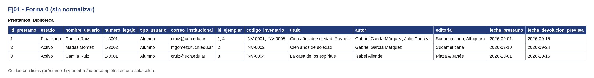
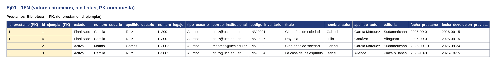
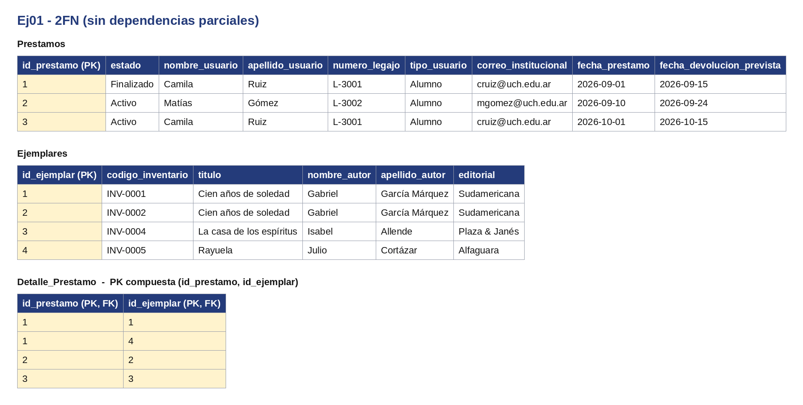
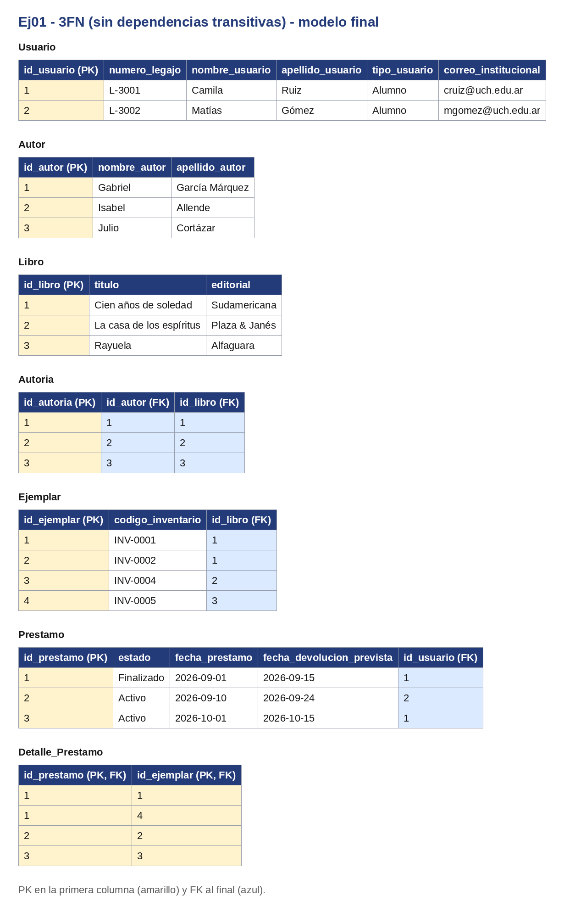

 Sistema de Gestión para una Biblioteca Universitaria

 Diagrama ER

 Lógica y Decisiones de Diseño
* **Autores y Libros:** Se usa una entidad intermedia (*Autoria*) para resolver la relación N:M, ya que un libro puede tener varios autores y viceversa.
* **Libros y Ejemplares:** Un título de libro se vincula con 1:N ejemplares físicos reales para controlar el estado y la disponibilidad individual por código de inventario.
* **Préstamos:** Los usuarios (alumnos o docentes) realizan préstamos que se detallan ítem por ítem mediante una tabla intermedia que registra las fechas de préstamo, devolución prevista y real.

---

## Normalización

Se muestra el proceso completo. En todas las tablas la PK va en la primera columna y las FK al final. Los datos son de ejemplo.

**Forma 0.** Una sola tabla con todo junto. El préstamo 1 tiene dos ejemplares en la misma celda y los nombres vienen completos en una columna.

**1FN.** Se separan nombre y apellido, el préstamo con dos ejemplares pasa a dos filas y la clave queda compuesta: (`id_prestamo`, `id_ejemplar`).

**2FN.** Los datos del préstamo dependen solo de `id_prestamo` y los del ejemplar solo de `id_ejemplar`, así que se separan en `Prestamos`, `Ejemplares` y `Detalle_Prestamo`.

**3FN.** Los datos del usuario dependen del legajo y el título, la editorial y el autor dependen del libro, no del ejemplar. Quedan `Usuario`, `Libro`, `Autor` y la intermedia `Autoria` (N:M).

El segundo ejemplar del préstamo 1 es un dato agregado para que se vea la lista en la Forma 0.

---

## SQL

El script `script.sql` crea las tablas con sus claves primarias y foráneas y carga datos de ejemplo. Está probado en SQLite (con `PRAGMA foreign_keys = ON;`).
